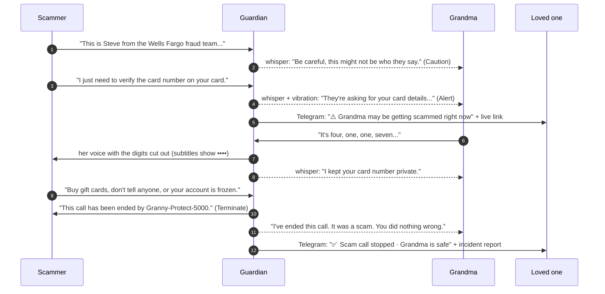
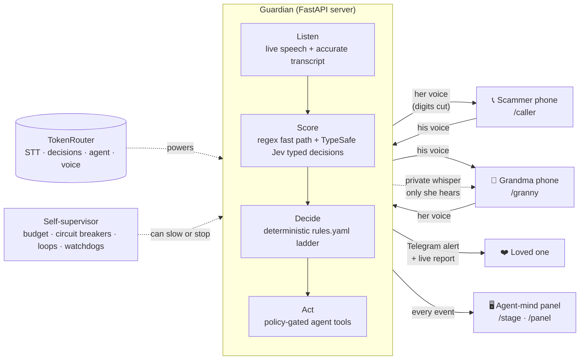

# Granny-Protect-5000

**An invisible AI guardian that sits inside the phone call and stops scams while they are happening.**

Grandma installs nothing and learns nothing. She just talks. The guardian listens to both sides in real time, scores how likely the call is a scam, and steps in only when it has to: it whispers private warnings only she can hear, hides her bank or card number from the caller, checks the caller's identity when it is unsure, hangs up on the scammer, and texts a loved one on Telegram with a live report. It also supervises itself, so it can stay on duty for hours with nobody watching.

> Built in one day at **c0mpiled-16 (UCSD)** for the **Unsupervised** track. Every model call (speech-to-text, decisions, agent reasoning and voice) runs through **TokenRouter** on a single key.

---

## The problem

Every day, scammers call elderly people pretending to be their bank, the police, or a grandchild in trouble. In 2024, Americans over 60 reported **about $4.9 billion** in fraud losses to the FBI, a 43% jump in one year, with an average loss of roughly $83,000 per victim ([FBI IC3 Elder Fraud Report 2024](https://www.aarp.org/money/scams-fraud/fbi-report-fraud-2024.html)). Those are only the reported cases.

These scams happen **live, on the phone**. A spam filter can't judge what is being said, a scam-awareness app needs Grandma to remember it in a panic, and family only finds out after the money is gone. The dangerous moment is a few seconds long: the moment she starts reading out her card number.

## Our answer

Put the protection **inside the call**, at that exact moment.

| | Granny-Protect-5000 |
|---|---|
| **Invisible** | No app, no buttons, no training. Grandma answers the phone the way she always has. |
| **Protective** | Private whispers, live redaction of card and account numbers, identity checks, and a hang-up when the danger is clear. |
| **Connected** | A trusted loved one gets a Telegram alert with a live report link while the call is still happening. |
| **Trustworthy** | Models produce signals. A written rule table decides. The AI agent can only use the tools the rules have unlocked, and every action is logged with the rule that allowed it. |
| **Unsupervised** | It watches its own spending, errors, loops and confidence, and knows when to slow down or stop. |

## Impact

- **The scammer gets nothing.** In our live tests, 0.00 s of Grandma's private questions leaked to the caller, and every digit of her card number was cut while the rest of the sentence came through.
- **Grandma never has to spot the scam herself.** The guardian tells her, in plain words, what is happening and one safe sentence to say.
- **Family knows in seconds, not weeks.** The Telegram alert arrives while the call is live, with who the caller claims to be and what they want.
- **Real emergencies still get through.** When a "grandson" asks for money, the guardian asks a family question only he would know instead of hanging up on someone who might be real.
- **It costs almost nothing to run.** About **$0.0003 per call** in model spend, and the guardian enforces its own budget.

---

## How a scam call plays out

The demo uses three screens: the **scammer's phone** (`/caller`), **Grandma's phone** (`/granny`), and the **agent's mind** on the projector (`/stage` or `/panel`), which shows every signal, score, rule and tool call live.



The scammer never hears a whisper, never sees a warning, and never hears the digits. After the call, an incident report opens with a plain-language story of what happened, a "What to do now" step, the masked transcript, every decision and the rule behind it, and the cost.

## Architecture



- **Transport:** each phone keeps one WebSocket (`/ws/caller`, `/ws/granny`) carrying 16 kHz PCM audio in 40 ms chunks plus control messages. The panel subscribes to `/ws/panel` for typed events. One server origin serves the frontend and all sockets.
- **Audio never routes phone to phone.** It always passes through the guardian, which is what lets it delay, cut, or end the line.
- **Separate lanes.** Audio has its own per-phone send queue and writer task, so slow model calls or text messages can never stall the voice.

---

## Features

### 1. Live two-way calling, built for quality
- Real calls between two devices in the browser (LAN HTTPS with `make lan`, or an ngrok / Cloudflare tunnel for remote devices).
- AudioWorklet mic capture with an anti-aliasing filter, downsampled to 16 kHz.
- Adaptive jitter buffer (80 ms start, 60–300 ms range) with gentle catch-up playback so latency doesn't build up.
- **No added delay on ordinary calls.** A 700 ms protection delay switches on only when the call turns risky, which gives the guardian time to cut digits before they reach the scammer.
- A phone page opened on a second device takes over the line, and the old one says so.

### 2. Live subtitles on both phones
Both screens show a running transcript. The scammer's subtitles never include Grandma's private questions, the guardian's whispers, or her digits (they show `••••`).

### 3. Hybrid transcription
- **Instant words:** Chrome Web Speech on each phone gives partial transcripts within milliseconds. These drive the number guard.
- **Accurate words:** at each turn end, the server sends that turn's audio to TokenRouter `voxtral-small` for a clean transcript, which is what the agent reasons on. A filter rejects model replies that aren't transcripts.
- If a phone's browser speech recognition stalls, the supervisor switches that phone to server-side transcription and back when it recovers.

### 4. Scam scoring and the escalation ladder
- **Fast path:** regex catches authority claims (banks, IRS, police, Medicare, "your grandson"), payment words (gift cards, wire, crypto) and digit runs in under 5 ms. On its own it can only reach Caution, since keywords can't see negation.
- **Typed decisions:** TokenRouter **TypeSafe Jev** returns typed answers (yes/no, scores, choices) for each red flag: claims authority, requests credentials, unusual payment, urgency, secrecy, threats, plus an overall scam score. An LLM JSON fallback and regex sit behind it.
- **Deterministic policy:** [`rules.yaml`](backend/app/policy/rules.yaml) turns signals into a level. Levels only go up.

| Level | When (examples of rules) | Grandma hears | Scammer hears |
|---|---|---|---|
| **0 Monitor** | default | nothing | the normal call |
| **1 Caution** | one red flag, or score ≥ 0.5 | "Be careful, this might not be who they say." | nothing |
| **2 Alert** | two red flags, score ≥ 0.8, a remembered scam script, or an unanswered identity check | a warning naming who they claim to be, one safe sentence to say, and a vibration | nothing |
| **Number guard** | she starts saying digits once the call is risky or credentials were requested | "I kept your card number private." | silence for the digits only |
| **3 Terminate** | alert plus secrecy or threats, score ≥ 0.98, a second number attempt, a failed identity check, or "Guardian, hang up" | "I've ended this call. It was a scam. You did nothing wrong." plus how to check safely | "This call has been ended by Granny-Protect-5000." |

### 5. Dynamic redaction of bank and card numbers
Only bank account and card numbers are protected, and the call keeps going normally. When Grandma starts reading digits, the guardian cuts exactly that span of her audio (with a short lead and tail so the first digit doesn't slip out) from what the scammer hears, then lets her voice through again. A second attempt to read a number counts as a strong scam sign and leads to a hang-up.

### 6. Private whispers
Every line Grandma hears is pre-generated with TokenRouter `gpt-audio-mini` in a warm, natural voice and checked against its own transcript, so there's no robotic fallback and no delay. Whisper audio that leaks back into her mic is recognized and ignored, so the guardian never reacts to itself.

### 7. "Guardian, is this real?"
Grandma can ask the guardian directly at any time. Her question is cut from the line before the caller hears it, and the guardian answers privately with what it knows so far. "Guardian, hang up" ends the call for her.

### 8. Identity verification, only when unsure
Real emergencies and grandparent scams sound the same, so the guardian checks identity only when the picture is mixed, and its reasoning is shown on the panel:
- **Family claims** ("Grandma, it's me") with a money, urgency, secrecy or credential ask: the guardian asks the caller a family question only the real person would know (from [`family_facts.yaml`](backend/family_facts.yaml)).
- **Institution claims** with a mixed score: the guardian asks whether Grandma may call them back on the official number. Real banks say yes; scammers push back.
- A correct family answer marks the caller as verified and only hard rules can escalate after that. A wrong answer or a refused call-back is treated as a scam. No answer within 15 s raises the call to Alert.

### 9. Trusted-person alerts on Telegram
When the call reaches Alert, a loved one gets *"⚠️ Grandma may be getting scammed right now"* with who the caller claims to be, what they want, the scam likelihood, and a **live report link** that updates every few seconds. After the hang-up they get *"✅ Scam call stopped · Grandma is safe"* with what the scammer got (nothing) and the next step. Practice and replay calls never message family.

### 10. Scam memory
When the guardian stops a scam, it remembers the script. The next caller who uses it is recognized on the first line and the call goes straight to Alert.

### 11. Incident report
After every call: a plain-language story of what happened, "What to do now", identity check results, a masked transcript, every decision with the rule that fired, every tool call, and the cost.

### 12. The agent-mind panel
`/stage` (for the projector) and `/panel` (detailed) show the live dual transcript, signal bars, the level ladder, each rule as it fires, tool calls with arguments and results, **blocked-by-policy** attempts in red, verification cards, and the supervisor's health. Press **H** to hide it and show "this is all Grandma experiences".

---

## Unsupervised: the guardian supervises itself

| Question | How it knows | What it does |
|---|---|---|
| **Overspending?** | Every model call is priced (Jev reports exact cost; chat models are priced from token usage), per call and per shift. | At 80% of the shift budget: **economy** mode (agent paused, typed decisions kept). At 100%: **rules-only** (regex plus policy). Protection never stops; spending does. |
| **Looping?** | Repeated identical tool calls, more than 2 whispers in 10 s, the agent retrying refused tools | Blocks the duplicate, holds the whisper so Grandma isn't overwhelmed, suspends the agent until the level changes. |
| **Stuck?** | Per-provider circuit breakers, slow calls, voice with no transcript for 7 s, a decision backlog | Falls back Jev → LLM → regex. Switches a stalled phone to server transcription. Skips stale turns. |
| **Should stop?** | 3 min of silence, a call over 30 min, a phone gone for 15 s, autopilot limits | Ends the call cleanly. Autopilot stops itself at shift end, at budget, after 3 failures in a row, or after 3 self-check misses in a row. |

**Autopilot shift** (panel drawer, or `POST /api/autopilot {"minutes":120}`) keeps the guardian working between live calls. It replays test calls through the real pipeline, grades itself, and steps aside the moment a real call comes in. A real run: 8 calls, 100% accuracy, $0.0026, then it stopped itself.

A heartbeat on the panel shows the current mode, spend, breaker states and any self-healing actions.

## Why it's safe to let an AI do this

**The models are probabilistic, but the decisions aren't.**
1. Models only produce **typed signals** (yes/no answers, scores, choices).
2. A **written rule table** turns signals into a level. Every decision records the rule ID.
3. The LLM agent chooses the words, but it can only call the tools unlocked at the current level. Anything else returns `blocked_by_policy`, which the panel shows.

| Level | Tools unlocked |
|---|---|
| 0 | `log_event`, `verify_caller` |
| 1 | + `whisper_to_granny`, `challenge_caller` |
| 2 | + `vibrate_granny`, `notify_family` |
| 3 | + `terminate_call` |
| Number guard (any level) | `redact_sensitive_number`, `end_redaction`, `mute_granny_to_caller`, `unmute_granny` |
| After the call | `write_incident_report`, `notify_family`, `log_event` |

The same tools are served over **MCP** at `/mcp` (FastMCP).

## The TokenRouter pipeline (one key)

| Stage | Model via TokenRouter | Fallback |
|---|---|---|
| Accurate transcript | `mistralai/voxtral-small-24b-2507` | Browser speech text |
| Typed decisions | `typesafe/jev-1.14` (yes/no, score, choice) | LLM JSON, then regex |
| Agent reasoning and report | `openai/gpt-4o-mini` with tool calling | Deterministic agent |
| Grandma's voice | `openai/gpt-audio-mini`, pre-generated and transcript-verified | Best on-device voice |
| Live words (instant) | Chrome Web Speech on each phone | Server transcription |

Every stage has a fallback, and each provider can be set to `mock` in `.env` to run fully offline.

---

## Try the five demo cases

Full Grandma and caller scripts are in [`DEMO_SCRIPTS.md`](DEMO_SCRIPTS.md), and each case also exists as a replayable script in [`backend/scripts/`](backend/scripts).

| Case | What the guardian should do |
|---|---|
| 1. Obvious scam (fake Wells Fargo, card number, gift cards, threats) | Caution → Alert → digits hidden → hang up, two Telegram messages |
| 2. Less obvious scam (polite "bank" with a mixed picture) | Call-back identity check, then escalate when the caller refuses |
| 3. Social engineering ("Grandma, it's me, I'm in trouble") | Family question; wrong answer means scam and hang up |
| 4. Not a scam, but asking for money (real grandson) | Family question; right answer means verified, no hang-up |
| 5. Normal conversation | Stays silent the whole call |

## Getting started

**Requirements:** Python 3.12+ with [uv](https://docs.astral.sh/uv/), Node 20, Chrome. A TokenRouter API key (or run everything in mock mode).

```bash
git clone https://github.com/SVstudent/GrannyProtect.git && cd GrannyProtect
cp .env.example .env              # add TOKENROUTER_API_KEY (and Telegram, below)
make install && make build        # once
make lan                          # HTTPS on the local Wi-Fi, prints the three URLs
```

| Device | Open | Notes |
|---|---|---|
| Grandma's phone | `https://<laptop-ip>:8443/granny` | Tap **Advanced → Proceed** once (self-signed cert), then **Answer** |
| Scammer's phone or laptop | `https://<laptop-ip>:8443/caller` | Tap **Call Grandma** |
| Projector | `https://<laptop-ip>:8443/stage` or `/panel` | Press **H** to hide the panel |

`make lan` keeps audio in the room, so a slow venue connection can't make the call choppy. Only the small model calls go out to TokenRouter. For devices on different networks, run `make backend` and then `make tunnel` (Cloudflare) or `ngrok http 8000`.

### Telegram setup (about 2 minutes)
1. In Telegram, message **@BotFather** → `/newbot`, and put the token in `.env` as `TELEGRAM_BOT_TOKEN=…`. Set `PROTECTED_NAME=Grandma` and `PUBLIC_URL` to your public address so the report links open.
2. The loved one opens the bot and sends it any message. The chat ID is discovered automatically.
3. Restart the server and run `curl -k -X POST https://localhost:8443/api/telegram/test`. Their phone should buzz. `GET /api/telegram` shows the status.

### Useful commands
| Command | What it does |
|---|---|
| `make replay SCRIPT=case1_obvious_scam` | Prints the full decision trace for a script and streams it to an open panel (also the demo backup) |
| `make voices` | Pre-generates every whisper in the natural voice |
| `curl -k -X DELETE https://<ip>:8443/api/memory` | Clears scam memory so the next call climbs the whole ladder |

## Testing

- **`make test`:** 60 pytest tests covering the policy ladder, regex and digit detection, redaction timing, identity verification, the supervisor (budget modes, loops, circuit breakers), the guardian ask, scam memory, Telegram message building, and replays of all 11 scripted calls landing on their expected outcome. Legit calls never reach Terminate.
- **`make e2e E2E_BASE=https://<laptop-ip>:8443`:** two real Chrome phones call each other with live audio. It checks two-way speech transcribed back word for word, private questions not leaking, digits cut while the voice resumes after, whispers reaching only Grandma, the hang-up, and the report.
- **`e2e/voice_only_e2e.py`:** the scammer only speaks, with no browser speech recognition. The guardian heals itself onto server transcription and still hangs up.

## Project structure

```
backend/
  app/
    main.py            FastAPI app: phone and panel sockets, REST API, serves the frontend
    call.py            CallSession: audio relay, delay line, redaction, whispers, verification, reports
    hub.py             per-phone sockets and audio send queues
    signals/           regex fast path, typed decision model, scam-signs reference
    policy/            rules.yaml escalation ladder + deterministic engine
    agent/             policy-gated tools and the LLM agent loop
    stt/  tts/         TokenRouter transcription refine, pre-generated whisper voice
    supervisor.py      budgets, circuit breakers, loop detection, watchdogs, heartbeat
    autopilot.py       self-grading shift between live calls
    verify.py          family question and call-back identity checks
    notify.py          Telegram (and Discord) trusted-person alerts
    memory.py          scam script memory (SQLite)
    mcp_server.py      the same tools over MCP
  scripts/             11 replayable calls, including the 5 demo cases
  tests/               pytest suite
frontend/              React + Vite: /caller, /granny, /stage, /panel, /report/:id
e2e/                   Playwright real-browser call tests
DEMO_SCRIPTS.md        Grandma and caller scripts for the 5 cases
PROTOCOL.md            the guardian's protocol, version by version
```

## Privacy and responsible use

- No audio is stored. Only the transcript and decision log are kept (SQLite), for the report, and the report's transcript masks Grandma's digits.
- Family facts for identity checks stay on the device in a local file.
- A production version would announce the guardian at the start of the call, since states like California require all-party consent to recording.

## What's next

- Run on a real phone line (SIP or carrier integration) instead of browser phones.
- More languages, and family-question setup through the loved one's Telegram.
- Shared scam memory across households, so a script caught once is caught everywhere.
